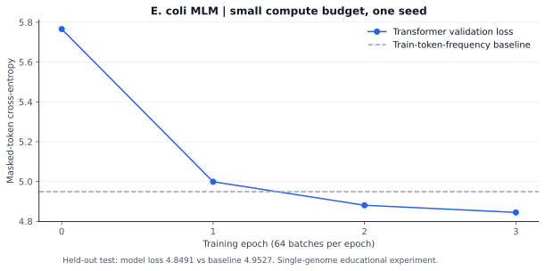

# DNA Transformer from scratch

A PyTorch masked-language-modeling experiment for DNA, with a train-only BPE tokenizer, custom attention with ALiBi-style distance bias, and explicit genomic-region evaluation.

[](https://github.com/Almizan-khan/-DNABERT-Style-Transformer-From-Scratch/actions/workflows/checks.yml)


## Engineering focus

- Custom embeddings, multi-head self-attention, encoder blocks and masked-token prediction head.
- FASTA parsing, ambiguous-window filtering, genomic-region splits and reverse-complement duplicate filtering.
- Reproducible 80/10/10 masking, validation-selected checkpoints, held-out test evaluation and a train-token-frequency baseline.

This is a small educational model inspired by DNABERT-style pretraining. It is not the published DNABERT-2 architecture, checkpoint, training corpus or benchmark reproduction.

## Run locally

Use Python 3.11 and a suitable CPU or CUDA PyTorch installation:

```bash
python -m venv .venv
source .venv/bin/activate
python -m pip install -r requirements.txt
python benchmark.py --output reports/smoke-benchmark.json
python prepare_data.py --output data/ecoli.fna
python train.py --fasta data/ecoli.fna --hidden 64 --heads 4 --layers 2 --vocab-size 256 --window 256 --batch-size 16 --epochs 3 --max-batches 64 --output outputs/ecoli-small
python -m unittest discover -s tests -v
```

The smoke benchmark generates random DNA and checks the training/evaluation path on CPU. The download command retrieves the original project's E. coli assembly, NCBI `GCF_000005845.2`, and records its URL and SHA-256. The final training command is a deliberately small experiment: at most 64 training batches per epoch. Remove `--max-batches` to process every training window. Use `--device cuda` when available.

## Data and evaluation protocol

Each FASTA record is divided into contiguous 70% / 15% / 15% regions, with a full-window gap before validation and test. Windows never cross region boundaries. Windows containing non-ACGT characters are excluded rather than joining sequence across ambiguous bases. Exact duplicate windows and reverse complements are removed across splits. BPE is fitted only on training windows.

At least one eligible token per sequence is selected for prediction. Selected tokens are masked 80% of the time, replaced with a random non-special token 10%, and left visible 10%. Validation masking is fixed across epochs. The checkpoint with the lowest validation loss is evaluated once on the test regions.

| Output | Contents |
|---|---|
| `metrics.json` | Masked-token loss, perplexity, accuracy, unigram baseline, configuration, seed and environment |
| `split_manifest.json` | Record IDs and genomic coordinates for every retained window |
| `tokenizer.json` | Training-only BPE vocabulary and configuration |
| `model.pt` | Selected weights and architecture configuration |

## Evidence and interpretation

[CI](https://github.com/Almizan-khan/-DNABERT-Style-Transformer-From-Scratch/actions) runs masking, splitting, padding-invariance and finite-gradient tests, plus a tiny synthetic training experiment. Synthetic results establish execution, not biological usefulness. The separate genome experiment records results on the downloaded assembly.

Perplexity depends on the tokenizer and masking protocol and should not be compared across different tokenizations as if it were one shared scale. A unigram baseline can be difficult to beat in a small run. The original notebook's partial training output is retained as historical material, not a completed evaluation.

## Measured E. coli experiment



| Held-out test metric | Result |
|---|---:|
| Transformer masked-token loss | **4.8491** |
| Train-token-frequency baseline loss | 4.9527 |
| Masked-token accuracy | 7.18% |
| Evaluated targets / genomic windows | 30,642 / 2,718 |
| Parameters | 137,408 |

[Raw metrics and data hash](reports/ecoli-small.json) · [Executed genome run](https://github.com/Almizan-khan/-DNABERT-Style-Transformer-From-Scratch/actions/runs/42401778845)

This single-seed run used three epochs capped at 64 batches of 16 windows per epoch, with a 256-token BPE vocabulary. The small loss improvement over the frequency baseline is modest evidence of learning under this protocol, not a claim of biological discovery or downstream predictive utility. The archive includes the tokenizer, genomic split manifest and selected checkpoint while the workflow artifact remains available.

## Research limits and next experiment

Contiguous regions and duplicate filtering reduce obvious leakage but do not eliminate homologous sequence similarity. A stronger follow-up should use sequence-cluster or species holdouts, multiple seeds and a downstream task with explicit labels. Compare k-mer and BPE tokenization under a fixed parameter/training budget before increasing model size. MLM loss alone does not establish variant-effect prediction, regulatory-function prediction or clinical value.

The original notebook and architecture asset remain in the repository. See [validation](VALIDATION.md) and [original description](docs/original-readme.md).

## References

- [DNABERT-2 implementation and GUE evaluation](https://github.com/MAGICS-LAB/DNABERT_2)
- [ALiBi](https://arxiv.org/abs/2108.12409)
- [NCBI assembly source](https://ftp.ncbi.nlm.nih.gov/genomes/all/GCF/000/005/845/GCF_000005845.2_ASM584v2/)
